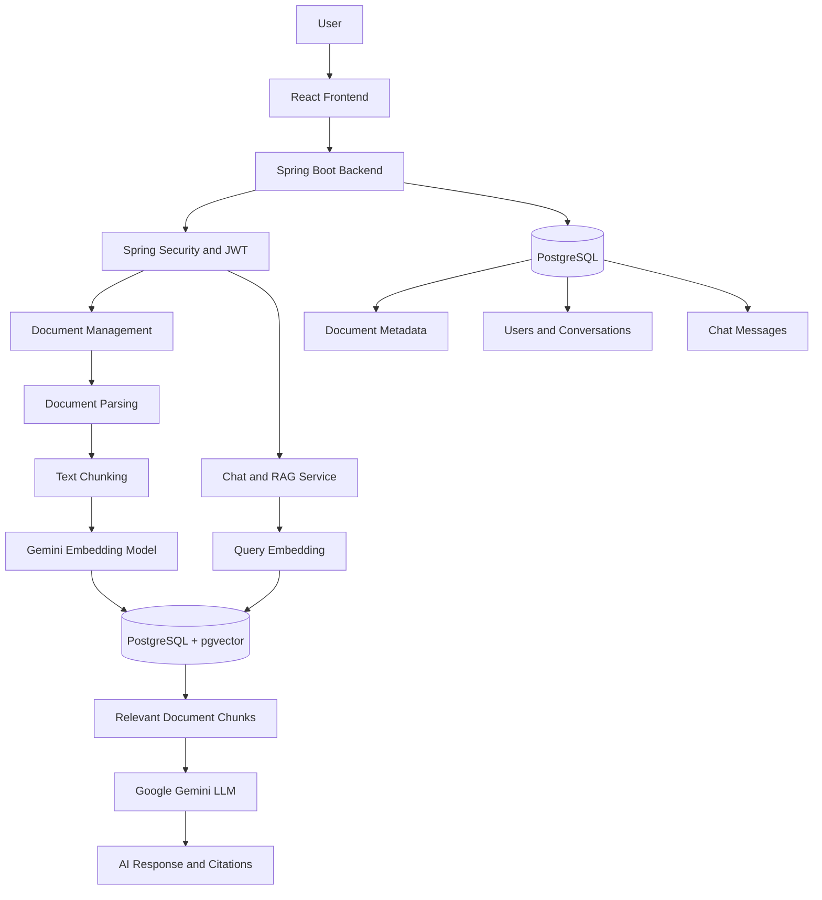

# ContextIQ – AI-Powered Document Intelligence System

**ContextIQ** is a full-stack AI-powered document intelligence platform built using **Spring Boot, Spring AI, Google Gemini, React, and PostgreSQL with pgvector**.

It uses **Retrieval-Augmented Generation (RAG)** to allow users to upload documents, generate and store their embeddings, and ask natural-language questions based on the content of their documents.

Users can interact with individual documents or search across their uploaded documents, receive context-aware AI responses, explore relevant document chunks, and maintain conversations with persistent chat history.

---

## Key Features

### 1. Document Management
- Upload individual documents.
- Upload multiple documents simultaneously.
- Parse and extract text from supported document formats.
- Store document metadata, including file name, content type, file size, page count, and processing status.
- Track document processing states: `UPLOADING`, `PROCESSING`, `INDEXED`, and `FAILED`.
- View uploaded documents and their details.
- Delete documents and their associated vector records.

### 2. Document Processing and Embeddings
- Extract document content using Spring AI document readers.
- Split extracted text into smaller chunks using `TokenTextSplitter`.
- Configure chunk size and overlap.
- Generate vector embeddings using Google's `gemini-embedding-001` model.
- Enrich chunks with metadata such as document ID, file name, chunk index, and page number.
- Store embeddings and metadata in PostgreSQL using pgvector.
- Configure HNSW indexing and cosine-distance similarity search.

**Document processing configuration:**

| Configuration | Value |
|---|---:|
| Maximum file size | 25 MB |
| Maximum multipart request size | 50 MB |
| Chunk size | 600 |
| Chunk overlap | 100 |
| Top-K retrieval | 5 |
| Embedding model | gemini-embedding-001 |
| Configured vector dimensions | 1536 |

### 3. RAG-Based Question Answering
- Convert user questions into embeddings.
- Retrieve relevant document chunks through semantic similarity search.
- Generate context-aware responses using Google Gemini.
- Support document-specific question answering.
- Support searching across the user's uploaded documents.
- Include relevant document context in the LLM prompt.
- Return source citations with generated answers.

### 4. Chat and Conversation Management
- Normal chat responses.
- Streaming AI responses.
- Conversation ID-based chat management.
- Persistent chat memory using a custom JPA-based Spring AI `ChatMemory` implementation.
- Store conversations and messages in PostgreSQL.
- Maintain conversation continuity across follow-up questions.
- Retrieve the last 10 messages as configured in chat memory.
- Keep retrieved document context separate from actual user messages in conversation history.

### 5. Semantic Search and Chunk Exploration
- Perform standalone semantic searches.
- Search within a selected document.
- Configure the number of retrieved results.
- View relevant document chunks.
- Display chunk index and page number.
- Display similarity scores and associated metadata.

### 6. Authentication and Authorization
- User registration and login.
- JWT-based authentication.
- BCrypt password hashing.
- JWT authentication filter.
- Stateless authentication using Spring Security.
- Role-based authorization with `USER` and `ADMIN` roles.
- Authenticated user identification for chat and document operations.
- User-specific document retrieval through metadata filtering.

### 7. API Documentation
- Swagger UI integration using Springdoc OpenAPI.
- API descriptions using `@Operation` and `@Tag`.
- Centralized OpenAPI configuration.
- JWT Bearer authentication support in Swagger UI.
- Test protected endpoints by providing an access token through Swagger's **Authorize** option.

### 8. Error Handling and Configuration
- Global exception handling using `@RestControllerAdvice`.
- Custom exceptions for resource and document-processing errors.
- Request validation using Jakarta Validation.
- Standardized API responses.
- Configurable CORS policies.
- Centralized application configuration using Spring Boot properties.

### 9. Frontend
- React.js and TypeScript-based user interface.
- Tailwind CSS styling.
- Login and registration pages.
- Protected routes.
- Zustand state management.
- Axios-based backend integration.
- Automatic JWT attachment through Axios interceptors.
- Document dashboard and upload interface.
- Chat interface with normal and streaming modes.
- Conversation history persistence using browser local storage.
- Semantic search interface.
- Document chunk exploration.
- User profile menu and logout functionality.

---

## Technology Stack

| Category | Technologies |
|---|---|
| Backend | Java, Spring Boot |
| AI Framework | Spring AI |
| LLM | Google Gemini |
| Embedding Model | Gemini Embedding |
| RAG | Retrieval-Augmented Generation |
| Database | PostgreSQL |
| Vector Database | pgvector |
| ORM | Spring Data JPA, Hibernate |
| Vector Index | HNSW |
| Similarity Search | Cosine Distance |
| Security | Spring Security, JWT |
| Password Hashing | BCrypt |
| API Documentation | Swagger, OpenAPI |
| Frontend | React.js, TypeScript |
| Styling | Tailwind CSS |
| State Management | Zustand |
| HTTP Client | Axios |
| Streaming | Reactive Flux, Fetch API |
| Containerization | Docker, Docker Compose |

---

## System Architecture

The application follows a client-server architecture.



---

## RAG Workflow

ContextIQ follows two main workflows.

### Document Ingestion

1. The user uploads a document.
2. The backend extracts its content.
3. The extracted text is divided into smaller chunks.
4. Metadata is attached to each chunk.
5. The Gemini embedding model converts each chunk into a vector.
6. The vectors and metadata are stored in PostgreSQL using pgvector.
7. The document processing status is updated to `INDEXED`.

### Question Answering

1. The user submits a question.
2. The question is converted into an embedding.
3. The vector database searches for semantically relevant chunks.
4. The most relevant chunks are retrieved.
5. Retrieved content is supplied as context to the Gemini model.
6. Gemini generates a context-aware response.
7. The application returns the answer along with relevant source information.

---

## Project Structure

```text
ContextIQ/
│
├── contextiq-backend/
│   ├── src/
│   │   └── main/
│   │       ├── java/
│   │       └── resources/
│   │           └── application.properties
│   │
│   ├── docker-compose.yml
│   └── pom.xml
│
├── frontend/
│   ├── src/
│   ├── public/
│   ├── package.json
│   └── ...
│
└── README.md
```

*The structure above is a high-level representation of the repository.*

---

## Getting Started

Follow these steps to run ContextIQ locally.

### Prerequisites

Make sure you have the following installed:

- Java 17 or the Java version configured by the backend project.
- Maven.
- Node.js and npm.
- Docker and Docker Compose.
- Google Gemini API key.
- PostgreSQL with pgvector support (Docker Compose is used in this project).

### 1. Clone the Repository

```bash
git clone https://github.com/sanketkumar100/ContextIQ.git
cd ContextIQ
```

### 2. Start PostgreSQL Using Docker

Navigate to the backend directory:

```bash
cd contextiq-backend
```

Start the database container:

```bash
docker compose up -d
```

The PostgreSQL service is configured to use:

| Setting | Value |
|---|---|
| Database | contextiq |
| Username | postgres |
| Password | postgres |
| Host port | 5434 |
| Container port | 5432 |

The database uses the pgvector PostgreSQL image and initializes the required vector extensions.

### 3. Configure Environment Variables

Configure the following environment variables before starting the backend:

```env
GOOGLE_GENAI_API_KEY=your_google_gemini_api_key
GOOGLE_CLOUD_PROJECT_ID=your_google_cloud_project_id

DB_HOST=localhost
DB_PORT=5434
DB_NAME=contextiq
DB_USERNAME=postgres
DB_PASSWORD=postgres
```

The backend also uses application properties for the Gemini model, embedding configuration, vector-store settings, JWT configuration, and other application settings.

**Important:** Configure your JWT secret using a strong secret value. Do not commit API keys, passwords, or JWT secrets to GitHub.

### 4. Run the Backend

From the `contextiq-backend` directory:

```bash
mvn spring-boot:run -Dspring-boot.run.profiles=dev
```

The backend runs on:

```text
http://localhost:8081
```

### 5. Run the Frontend

Open another terminal and navigate to the frontend directory:

```bash
cd frontend
```

Install dependencies:

```bash
npm install
```

Start the development server:

```bash
npm run dev
```

Open the local URL displayed by Vite in your terminal.

---

## API Documentation

ContextIQ provides interactive API documentation through Swagger UI.

Once the backend is running, open:

**http://localhost:8081/swagger-ui/index.html**

Swagger provides:
- Available API endpoints.
- Request and response structures.
- Endpoint descriptions.
- JWT Bearer authentication.
- Interactive API testing.

To test protected endpoints, log in through the authentication API, copy the returned access token, and provide it through Swagger's **Authorize** option.

### Main API Endpoints

Base URL:

```text
http://localhost:8081/api/v1
```

| Method | Endpoint | Description |
|---|---|---|
| POST | `/auth/register` | Register a user |
| POST | `/auth/login` | Authenticate a user |
| POST | `/documents/upload` | Upload a document |
| POST | `/documents/upload-multiple` | Upload multiple documents |
| GET | `/documents/user` | Get current user's documents |
| GET | `/documents/{id}` | Get document details |
| DELETE | `/documents/{id}` | Delete a document |
| POST | `/chat/query` | Get a normal AI response |
| POST | `/chat/stream` | Get a streaming AI response |
| POST | `/chat/search/similarity` | Perform semantic similarity search |

Authenticated endpoints require a valid JWT Bearer token.

---

## Configuration Highlights

Some important application configurations include:

| Property | Description |
|---|---|
| `spring.servlet.multipart.max-file-size` | Maximum individual uploaded file size |
| `spring.servlet.multipart.max-request-size` | Maximum multipart request size |
| `spring.ai.google.genai.embedding.text.model` | Gemini embedding model |
| `spring.ai.vectorstore.pgvector.index-type` | Vector index type |
| `spring.ai.vectorstore.pgvector.distance-type` | Vector similarity distance |
| `spring.app.rag.chunk-size` | Text chunk size |
| `spring.app.rag.chunk-overlap` | Text chunk overlap |
| `spring.app.rag.top-k` | Number of retrieved chunks |
| `spring.app.rag.similarity-threshold` | Minimum similarity threshold |

Refer to the backend's application properties for the actual configured property names and values.

---

## Future Improvements

Potential areas for further development include:

- Backend APIs for listing, retrieving, and deleting conversations.
- Enhanced document-processing support and validation.
- More advanced retrieval and reranking strategies.
- Improved document ownership validation across all document operations.
- Deployment and production monitoring.

---

## Author

**Sanket Kumar**

- GitHub: [@sanketkumar100](https://github.com/sanketkumar100)
- Project Repository: [ContextIQ](https://github.com/sanketkumar100/ContextIQ)

---

## License

This project is developed for learning and portfolio purposes. Add a license file to the repository if you intend to distribute it under a specific open-source license.
